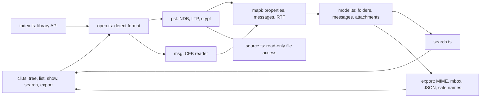

<p align="center"></p>

# pstpeek

> **Warning: alpha / experimental software (0.1.0-alpha).** The PST, OST and MSG readers were
> implemented from Microsoft's published specifications. Beyond synthetic fixtures, they have been
> checked on **only 22 small public sample files** (3 PST, 1 OST, 18 MSG; about 20 MB in total, see
> [Validation on public sample files](#validation-on-public-sample-files)). That is far from a
> corpus of real mailboxes: large, old, damaged or unusual archives are not validated. Output may be
> incomplete or wrong. Keep your original archive, and check exported results before you rely on them.

<p align="center">
  <a href="https://www.npmjs.com/package/pstpeek"></a>
  <a href="https://www.npmjs.com/package/pstpeek"></a>
  <a href="LICENSE"></a>
  
  
  
  
</p>

<p align="center">
  <a href="#why">Why</a> |
  <a href="#quick-start">Quick start</a> |
  <a href="#usage">Usage</a> |
  <a href="#architecture">Architecture</a> |
  <a href="#implementation-status">Status</a> |
  <a href="#limitations">Limitations</a> |
  <a href="#testing">Testing</a> |
  <a href="#roadmap">Roadmap</a> |
  <a href="#license">License</a>
</p>

**pstpeek** opens Outlook `.pst`, `.ost` and `.msg` files without Outlook. It lets you browse the folder
tree, list and search messages, and export everything to `.eml`, mbox or JSON, attachments included.

## Key features

All of the following were exercised by the test suite and, for the CLI, by real runs (see [Demo](#demo)):

- Reads Unicode and ANSI PST and `.msg` files, plus OST files (512-byte-page OST is untested on real data; Outlook 2013+ 4K-page OST is experimental). The format is detected from the file content.
- Commands: `tree`, `list`, `show`, `search`, `export`, each with machine-readable `--json` output where applicable.
- Exports to RFC 5322 `.eml` (7-bit, CRLF, RFC 2047/2231 encoding), mbox (mboxrd) or JSON, with attachments and attached Outlook items.
- Read-only (the source is opened with the read flag only), offline (no network, no telemetry), safe output names (no path traversal, no overwriting).
- Zero runtime dependencies: the PST/OST and MSG parsers are written from Microsoft's published specifications.
- Usable as a library (`openArchive`, `walkFolders`, `buildEml`, ...).

## Why

Old `.pst` archives outlive the Outlook installs that created them: former employees' mailboxes, family
archives, migrations to Thunderbird or another client, or simply a Mac or Linux machine with no Outlook.
The well-known open source viewer for Windows is no longer maintained, and most other options are
closed-source freeware or paid converters. pstpeek is a small, auditable command-line tool for getting your
mail out in standard formats. Please read [Limitations](#limitations) before relying on it.

## Quick start

Requires Node.js 22 or newer.

Install from npm (alpha release):

```sh
npm install -g pstpeek
pstpeek tree path/to/archive.pst
```

Or build from source:

```sh
git clone https://github.com/Emincanozen/pstpeek.git
cd pstpeek
npm install        # also compiles dist/ through the "prepare" script
npm run build      # explicit rebuild (optional after install)
npm test           # compile tests and run them with node:test
node dist/bin.js tree path/to/archive.pst
```

Optionally `npm link` puts the `pstpeek` command on your PATH; the examples below assume that. `dist/` is
not committed. On Windows PowerShell with a restricted execution
policy, call `npm.cmd` / `npx.cmd` instead of `npm` / `npx`.

## Demo

Real output of the compiled CLI on a **synthetic** PST generated by the test helpers (`test/helpers/`,
invented data, nothing from a real mailbox). Only the long absolute output path was shortened to `<cwd>`.

```text
$ pstpeek tree archive.pst
Sample Archive (0)
`-- Top of Personal Folders (0)
    |-- Inbox (2)
    |   `-- Été 2024 (1)
    `-- Deleted Items (0)

3 item(s) in 5 folder(s)

$ pstpeek list archive.pst --folder Inbox

== Sample Archive/Top of Personal Folders/Inbox (2)
    1  2024-03-05 14:03  Zoë Example <zoe@example.com>     Réunion 🌍 été – planning [2 att]
    2  2024-03-06 08:00  Dan Sender <dan@example.net>      Plain ASCII subject: weekly report

$ pstpeek search archive.pst needle
Sample Archive/Top of Personal Folders/Inbox #2  2024-03-06 08:00  Dan Sender <dan@example.net>
  Subject: Plain ASCII subject: weekly report
  body: Long body line with the needle-xyz marker. Long body line with the needle-xyz ma...

1 match(es)

$ pstpeek show archive.pst --folder Inbox --index 1
Folder:  Sample Archive/Top of Personal Folders/Inbox #1
Date:    2024-03-05T14:03:09.000Z
From:    Zoë Example <zoe@example.com>
To:      Ana Test <ana@example.com>, Bob "B" Test <bob@example.com>
Cc:      Chloé Copy <chloe@example.org>
Subject: Réunion 🌍 été – planning
Attach:  rapport été.txt (text/plain, 53 bytes)
Attach:  logo.png (image/png, 5008 bytes)

Bonjour Zoë,
Voir le rapport.

$ pstpeek export archive.pst -o out
Exported 3 item(s) with 3 attachment(s) from 5 folder(s) to <cwd>out (eml)
```

## Architecture



The PST layers follow [MS-PST]: the NDB layer (pages, B-trees, blocks, data trees), the LTP layer (heaps,
property contexts, table contexts) and the messaging layer (folders, messages, recipients, attachments).
`.msg` files go through a small Compound File Binary reader. Both feed the same in-memory model, which the
search and export code consume.

## Usage

```text
pstpeek tree   <file> [--json]
pstpeek list   <file> [--folder <path>] [--limit <n>] [--json]
pstpeek show   <file> --folder <path> --index <n> [--json]
pstpeek search <file> <text> [--folder <path>] [--limit <n>] [--case-sensitive] [--json]
pstpeek export <file> -o <dir> [--format eml|mbox|json] [--folder <path>]
```

`<file>` may be a `.pst`, `.ost` or `.msg` file; the format is detected from the file content.

### Folder tree

```text
$ pstpeek tree archive.pst
Sample Archive (0)
`-- Top of Personal Folders (0)
    |-- Inbox (2)
    |   `-- Été 2024 (1)
    `-- Deleted Items (0)

3 item(s) in 5 folder(s)
```

Counts are the number of items stored directly in each folder.

### Listing and reading messages

```text
$ pstpeek list archive.pst --folder Inbox
== Sample Archive/Top of Personal Folders/Inbox (2)
    1  2024-03-05 14:03  Zoë Example <zoe@example.com>     Réunion 🌍 été – planning [2 att]
    2  2024-03-06 08:00  Dan Sender <dan@example.net>      Plain ASCII subject: weekly report

$ pstpeek show archive.pst --folder Inbox --index 2
```

Folder paths use `/` between levels and are matched case-insensitively. A path may start at any level, so
`--folder Inbox` and `--folder "Top of Personal Folders/Inbox"` both work (the first match wins). Use `\/`
for a slash inside a folder name. Without `--folder`, `list` walks every folder. Dates are shown in UTC.

### Search

```text
$ pstpeek search archive.pst "needle"
Sample Archive/Top of Personal Folders/Inbox #2  2024-03-06 08:00  Dan Sender <dan@example.net>
  Subject: Plain ASCII subject: weekly report
  body: Long body line with the needle-xyz marker. ...
```

A plain substring search (case-insensitive by default) over subject, sender, recipients, body text
(HTML bodies are converted to text) and attachment file names. It scans the file; there is no index.

### Export

```sh
pstpeek export archive.pst -o out/              # one .eml file per message (default)
pstpeek export archive.pst -o out/ -f mbox      # one mbox file per folder
pstpeek export archive.pst -o out/ -f json      # one .json per message + attachment files
pstpeek export archive.pst -o out/ --folder Inbox
```

- **eml**: RFC 5322 / MIME messages. Plain text and HTML bodies become `multipart/alternative`;
  inline images referenced by `cid:` go into `multipart/related`; other attachments are base64 parts;
  attached Outlook items become `message/rfc822` parts. Output is 7-bit ASCII with CRLF line endings:
  non-ASCII headers use RFC 2047 encoded words and attachment names use RFC 2231.
- **mbox**: mboxrd flavour (`From ` separator lines, `>From ` quoting), LF line endings, one file per folder
  laid out like the folder tree (`Inbox.mbox`, `Inbox/Projects.mbox`). Importable into Thunderbird
  (for example with the ImportExportTools NG add-on) and most mail tools.
- **json**: one file per message with headers, addresses, ISO 8601 dates, text and HTML bodies, the
  original transport headers when present, and the list of attachments. Attachments are written to a
  `<message> files/` directory next to the JSON file and referenced by relative path.

Folder and file names are made safe for every platform (no reserved characters, no Windows device names,
no path traversal, bounded length) and existing files are never overwritten: name collisions get a
` (2)` suffix.

### Library use

```ts
import { openArchive, walkFolders, buildEml } from 'pstpeek';

const archive = openArchive('archive.pst');
for (const folder of walkFolders(archive.root)) {
  for (const { message } of archive.messages(folder)) console.log(folder.path.join('/'), message.subject);
}
archive.close();
```

## Implementation status

"Synthetic fixtures" means files generated at test time by `test/helpers/`, written by the same author
from the same reading of the specification. "Public samples" are the files listed in the next section.

| Area | Status |
| --- | --- |
| PST, Unicode (Outlook 2003+) | Synthetic fixtures + 2 small public samples (Apache Tika test files), no errors |
| PST, ANSI (Outlook 97-2002) | Synthetic fixtures for shared code + 1 tiny public sample (one item), no errors |
| OST, Unicode (512-byte pages) | Same layout as Unicode PST; no OST-specific sample tested |
| OST, Outlook 2013+ (4K pages, compressed blocks) | Experimental. 1 public sample (40 folders, 3 items, 11 zlib-compressed blocks read) plus synthetic fixtures modeled on it; the CLI prints a warning |
| Encoding "compressible" (permute) | Synthetic fixtures + the 3 public PST samples (all use it) |
| Encoding "high" (cyclic) | Synthetic fixtures only; no public sample |
| Folders, messages, recipients, attachments, attached Outlook items | Synthetic fixtures + public samples (small numbers of each) |
| Plain text, HTML and compressed RTF bodies (HTML recovered from RTF when encapsulated) | Synthetic fixtures, one compressed-RTF test vector, public samples |
| `.msg` files (one message shown as a one-folder archive; loaded in memory, 256 MiB cap) | Synthetic fixtures + 18 public samples (mail, contact, appointment, task, note, post, attachments, embedded message, CJK, ANSI and Unicode properties), no errors |
| Multi-valued (PT_MV_*) properties | Decoded at the property level for .msg and PST; not mapped to any export field yet |
| Contacts, calendar items, tasks | Exported as generic items (subject, body, attachments); no vCard/iCalendar |

## Validation on public sample files

On 2026-11-18 the compiled CLI (`tree`, `list`, `search`, `show`, `export` in eml, mbox and json)
was run on these publicly available test files. They are **not** included in this repository.

| Source repository (license as stated by the repository) | Files | Detected format | Result |
| --- | --- | --- | --- |
| apache/tika (Apache-2.0) | `testPST.pst` | Unicode PST, permute | 5 folders, 7 items, 1 attached item; no errors |
| apache/tika | `testPST_variousBodyTypes.pst` | Unicode PST, permute | 6 folders, 4 items; no errors |
| apache/tika | 12 `testMSG*.msg` files (mail, appointment, contact, task, note, post, .doc and .msg attachments, Chinese text, forwarded, date-header cases) | MSG | 1 item each; no errors |
| mooijtech/go-pst (Apache-2.0) | `32-bit.pst` | ANSI PST (wVer 14), permute | 5 folders, 1 item; no errors |
| rjohnsondev/java-libpst (LGPL / Apache-2.0) | `example-2013.ost` | Outlook 2013+ OST (wVer 36, 4K pages) | 40 folders, 3 items (2 in Inbox, 1 in Sent Items), 11 zlib-compressed blocks; no errors |
| HiraokaHyperTools/msgreader (Apache-2.0) | `contactAnsi.msg`, `contactUnicode.msg`, `Simple.msg`, `Hello +CJK.msg`, `A memo.msg`, `test.msg` | MSG | 1 item each; no errors |

Checks made: no unreadable items; per-folder item counts equal each folder's own `PidTagContentCount`;
every `.eml` is 7-bit ASCII with CRLF line endings and a MIME-Version header; no U+FFFD in subjects,
bodies, names or attachment names; exported attachments start with the signature of their type
(JPEG, PDF, OLE/.doc, text); the ANSI and Unicode versions of the same contact decode to the same
subject and body. No independent reference tool (libpff, readpst, Outlook) was available, so counts were
not compared against another implementation, and message content was only spot-checked, not compared
field by field.

Defects found and fixed during this run, each reproduced first with a synthetic test:

- 4K-page OST files could not be opened: the page trailer is at offset 4072, not 4080.
- `PT_STRING8` values were decoded with the internet code page (for example ISO-2022-JP) instead of the
  matching Windows ANSI code page (932) when `PidTagMessageCodepage` is absent.

To rerun the optional integration test locally, download the files yourself and run
`PSTPEEK_SAMPLES=/path/to/samples npm test`; without the variable the test is skipped.

## Limitations

Please read these honestly before trusting an export:

- **Not validated on a corpus of real mailboxes.** Besides synthetic fixtures from a test-only writer
  that follows the same reading of the specification, only 22 small public sample files were checked
  (see above). Large archives, Outlook 97-2002 files with real content, cyclic ("high") encoding,
  damaged files and 512-byte-page OST files have not been tried on real data. Bug reports with details
  (never send private archives) are welcome.
- OST files from Outlook 2013 and later (4K pages, compressed blocks) are experimental: the layout
  was confirmed on a single public sample only. The CLI prints a warning when it opens one.
- Memory: a `.msg` file is read into memory and refused above 256 MiB (`openArchive(path, { maxMsgBytes })`
  changes the limit). PST/OST files are read with random access, but each body or attachment is
  assembled as one in-memory buffer during export, so a single very large attachment needs that much RAM.
- Hostile input: B-tree, heap, data-tree, subnode and CFB chains are bounded and cycle-checked, and
  compressed RTF is CRC-checked with a capped output size. This hardening is tested with crafted
  structures, not with a fuzzer.
- Export refuses to write through symbolic links or junctions found inside the output directory. The
  check runs before each directory is used, so a link created concurrently by another process is not
  prevented.
- Password-protected PSTs: the PST password is not a real encryption and pstpeek ignores it; content
  encoded with the standard permute or cyclic methods is decoded. Files encrypted by other means
  (for example rights-managed messages) cannot be read.
- Damaged files: unreadable items are skipped and reported as warnings; there is no recovery of deleted
  items and no repair mode.
- RTF-only bodies are converted to plain text (formatting is lost) unless they encapsulate HTML.
- Senders and recipients that only have an Exchange internal address (no SMTP address stored) are
  written with their display name and an empty address (`"Name" <>`).
- Search is a sequential scan without an index; very large archives take a while. Attached Outlook items
  are not searched.
- Exported dates are in UTC. Original transport headers are kept in JSON output but the `.eml` headers are
  rebuilt from MAPI properties.
- Named (custom) MAPI properties, categories, flags and read state are not exported. Multi-valued
  properties are decoded by the library (`PropertyBag.multi`) but no export format includes them yet.
- No GUI yet; the library API may change before 1.0.

## Dependencies and licenses

pstpeek has **no runtime dependencies**. Development dependencies, as installed in this repository:
`typescript` 5.9 (LICENSE.txt: Apache License 2.0), `@types/node` 22 (LICENSE: MIT) and its dependency
`undici-types` (package.json: MIT).

Parsing libraries considered. These are observations made on 2026-11-18 by reading the npm tarballs
(`npm pack`) and the GitHub REST API; packages change, so re-check before relying on this table.

| Library | What was read | Finding | Decision |
| --- | --- | --- | --- |
| `pst-extractor` 1.12.0 | Tarball file list, `package.json`, `readme.md`; GitHub API metadata and root listing of `epfromer/pst-extractor`; `README.txt` of `rjohnsondev/java-libpst` | "MIT" in `package.json` and the readme; no LICENSE file in the tarball or the repository root; GitHub reports `license: null`. The readme says it is based on `java-libpst`, whose `README.txt` says it is licensed under both the LGPL and Apache License v2.0. | Not used: no license text to redistribute, and the relationship to the upstream licenses is unclear. |
| `@hiraokahypertools/pst-extractor` 0.5.0-alpha.2 | Tarball file list and `package.json`; GitHub API metadata | "MIT" in `package.json`; no LICENSE file in the tarball; GitHub reports `license: null`. | Not used. |
| `@kenjiuno/msgreader` 1.29.0 | First lines of the tarball LICENSE, `package.json` | Apache License 2.0; depends on `@kenjiuno/decompressrtf` 0.1.4 (LICENSE: BSD 2-Clause) and `iconv-lite` (LICENSE: MIT text). | Usable, but not needed: a small CFB reader shares the PST code path and keeps zero dependencies. |

The PST/OST, CFB, MSG and compressed-RTF code was written from Microsoft's published Open
Specifications ([MS-PST], [MS-CFB], [MS-OXMSG], [MS-OXRTFCP], [MS-OXRTFEX]); no code from the libraries
above was used. The permute/cyclic substitution table was copied from [MS-PST] section 5.1. Check
Microsoft's Open Specifications pages for the terms that apply to implementations.

## Testing

```sh
npm run typecheck  # tsc --noEmit over src and test
npm test           # compile src + tests to build-test/ and run node:test
```

Last run on the code in this repository (Node.js 22.14, Windows): **89 tests, 88 passed, 0 failed, 1 skipped**.
The skipped test is the optional integration test on public sample files, which needs
`PSTPEEK_SAMPLES` (see [Validation on public sample files](#validation-on-public-sample-files)).
The CI workflow (`.github/workflows/ci.yml`) runs build and tests on Ubuntu, Windows and macOS with
Node.js 22 and 24.

Tests cover the MIME writer (encoded words, quoted-printable, RFC 2231 parameters, multipart structure,
header injection), mbox quoting, safe file names, compressed RTF, the substitution tables, the CFB/MSG
reader, and end-to-end PST reading and export, including permute- and cyclic-encoded files, multi-level
B-trees, large bodies stored in XBLOCK data trees, nested subnodes, attached Outlook items, missing tables
and corrupt items. The PST and MSG fixtures are generated at test time by `test/helpers/` from invented
data, so no third-party or real mailbox data is stored in this repository.

## Roadmap

Nothing below is promised; it is the list of known gaps, roughly in order of priority.

- Validate on more and larger real-world archives, including 512-byte-page OST and damaged files.
- Export contacts as vCard and calendar items as iCalendar.
- Export categories, flags, read state and named properties.
- Streaming of very large attachments to avoid per-attachment in-memory buffers.
- Fuzzing of the parsers.
- A cross-check against an independent reader (for example libpff) on shared test files.

## Contributing

Issues and pull requests are welcome: see [CONTRIBUTING.md](CONTRIBUTING.md). Security problems go through [SECURITY.md](SECURITY.md). Changes are listed in [CHANGELOG.md](CHANGELOG.md).

## License

[MIT](LICENSE) © pstpeek contributors.
